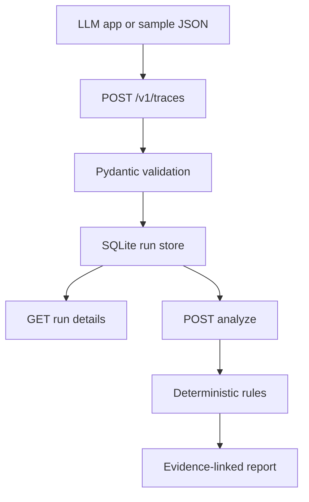

# Architecture

## Current MVP

TraceSentry is a local-first Python service with four small layers:

1. **HTTP API** — FastAPI validates requests and exposes ingestion, run listing, run inspection, and analysis endpoints.
2. **Schema boundary** — Pydantic models validate trace and span structure before persistence.
3. **Storage** — SQLite stores each submitted trace as JSON, keyed by a generated run ID. Set `TRACESENTRY_DB` to change the database location.
4. **Analysis rules** — deterministic heuristics report explicit span errors, empty retrieval signals, tool spans with inconsistent error attributes, and slow spans.

## Request flow

## Trace contract

A trace has a unique trace identifier and one or more spans. Spans contain IDs, an operation name, start time, duration, status, attributes, and optional events. Span attributes are treated as untrusted, potentially sensitive user data.

The MVP accepts a simplified provider-neutral format; it is not yet a full OTLP receiver. A future adapter should map OpenTelemetry resources, scopes, span status, events, and parent-child relationships into this internal schema.

## Analysis contract

Each finding has a stable rule code, severity, plain-language explanation, span IDs, and evidence extracted from the trace. Heuristics are intentionally transparent and conservative. A clean report means only that no current rule matched; it does not establish semantic correctness, factuality, or causal root cause.

## Planned extensions

- OpenTelemetry OTLP/HTTP ingestion and semantic-convention mapping.
- LangGraph instrumentation and trace correlation.
- Replay harness with recorded model/tool fixtures and deterministic seeds.
- Dataset-based evaluations and before/after comparison.
- Optional model-assisted diagnosis constrained to cite trace evidence.
- UI for trace timelines, span detail, and regression comparisons.
- Authentication, redaction, retention policies, and deployment hardening before multi-user hosting.
